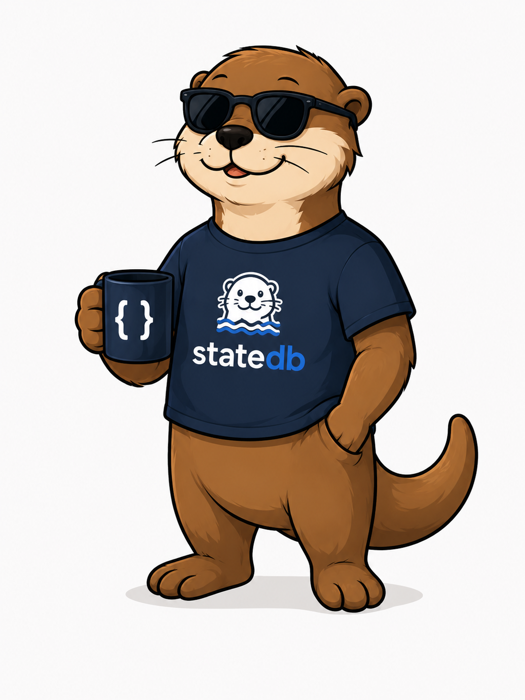

  <picture>
    <source media="(prefers-color-scheme: dark)" srcset="assets/brand/statedb-logo-dark.svg">
    
  </picture>

A self-hosted state management backend compatible with the Pulumi command-line tool. It implements HTTP state storage protocols and pairs them with a web console for browsing stacks and resources without requiring a managed cloud service.

End users configure their CLI to point at this service via `PULUMI_BACKEND_URL`. Existing workflows remain unchanged.

Third-party attributions and trademark notices are in [NOTICE](NOTICE).

## How we prove your state is safe

State backends earn trust through their failure modes, not their happy paths. statedb is tested in tiers:

- **Contract replay:** every HTTP exchange from real recorded Pulumi CLI sessions (`up`, `preview`, `refresh`, `destroy`, tags, rename, export/import, and more) is replayed against the server and must reproduce byte-for-byte modulo documented volatile fields.
- **Integrity verification:** every deployment the server assembles in tests is checked with Pulumi's own `snapshot.VerifyIntegrity` (via [`tools/pulumi/verify`](tools/pulumi/verify)), so stored state is state the CLI itself would agree to load.
- **CLI smoke:** the real Pulumi CLI, in Docker, driving the backend per command family.
- **Fault injection:** adversarial scenarios with the real CLI: killed mid-update, concurrent updates, failed deployments, corrupted imports, compaction and secrets durability. Each run emits a [State Safety Report](modules/pulumi-cli-smoke/README.md) listing every scenario and its outcome; the nightly CI matrix repeats it across supported Pulumi CLI versions.

See [`modules/pulumi-cli-smoke/README.md`](modules/pulumi-cli-smoke/README.md) for running the slow tiers locally and [`design/pulumi-state-testing-roadmap.md`](design/pulumi-state-testing-roadmap.md) for the full scenario catalog.

## License

state-db is open-source software under the [GNU Affero General Public License v3.0 only](LICENSE), identified as `AGPL-3.0-only`.

If you operate a modified version over a network, the AGPL requires you to offer its corresponding source to network users. The complete source for the official state-db service is available in the [state-db repository](https://github.com/state-db/statedb).

## Contributing

Contributions are welcome. Pull requests require the applicable [individual](CLA.md) or [corporate](CCLA.md) contributor agreement. See [CONTRIBUTING.md](CONTRIBUTING.md) for the acceptance workflow.
