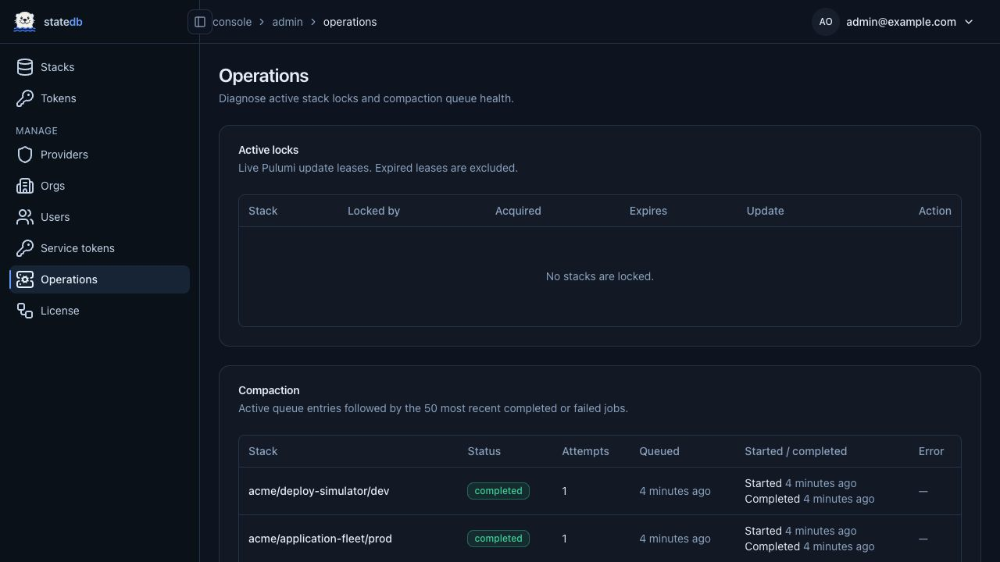

<div align="center">
  <picture>
    <source media="(prefers-color-scheme: dark)" srcset="assets/brand/statedb-logo-dark.svg">
    
  </picture>
</div>


statedb is a self-hosted state backend for [Pulumi](https://www.pulumi.com/), with a web console. It implements the Pulumi HTTP state protocol and stores everything in your PostgreSQL database, so an unmodified Pulumi CLI works against it:

```sh
pulumi login https://statedb.example.com/pulumi
```

Pulumi still runs your program and calls providers on your machine or CI runner. statedb stores the resulting state, history, and events; it never runs deployments.

## What you get

- **State in PostgreSQL.** Stacks, checkpoints, update history, and engine events live in one database that you back up and restore with your usual tools.
- **Locking and recovery.** Each update holds a renewable lease on its stack. An interrupted update releases the stack when the lease expires, or sooner with `pulumi cancel`.
- **A web console.** Browse stacks, resources, update history, and per-update resource changes. Administrators manage organizations, users, identity providers, and service tokens.
- **Sign-in through your identity provider.** OIDC for people, service account tokens for CI, and `pulumi login` through the browser. Organization roles are enforced with [Cedar](https://www.cedarpolicy.com/) policies.
- **Service-managed secrets.** statedb implements Pulumi's `service` secrets provider with a keyset stored in the database. Passphrase and cloud KMS providers also work; they encrypt on the client and statedb stores only ciphertext.
- **Pull request reports.** An optional GitHub App posts preview and update results on the pull request that triggered them.
- **One container.** A native executable with the console built in. It needs PostgreSQL and nothing else.

OpenTofu and Terraform state are not supported.



## Try it

You need Docker and the Pulumi CLI.

```sh
curl -O https://raw.githubusercontent.com/state-db/statedb/main/examples/compose.yml
docker compose -f compose.yml up
```

Open `http://localhost:8080` and sign in with the password `statedb`. Then, from any Pulumi project:

```sh
pulumi login http://localhost:8080/pulumi
pulumi stack init acme/dev
pulumi preview
```

This setup is for evaluation only: it hard-codes a password and a session secret. The [quickstart](site/src/content/docs/docs/quickstart.md) explains each step.

## Documentation

| To do this | Read |
| --- | --- |
| Install on Kubernetes, AWS, Azure, Google Cloud, or your own host | [Install](site/src/content/docs/docs/install/index.md) and [configuration](site/src/content/docs/docs/deployment.md) |
| Set up sign-in, roles, and service tokens | [Authentication](site/src/content/docs/docs/authentication.md) |
| Upgrade, back up, size, and monitor | [Operations](site/src/content/docs/docs/operations.md) |
| Move a stack to or from another backend | [Migration](site/src/content/docs/docs/migration.md) |
| See which CLI versions and commands are tested | [Compatibility](site/src/content/docs/docs/compatibility.md) |
| Understand how it works | [Architecture](site/src/content/docs/docs/architecture.md) and the [design reference](design/README.md) |

## How it is tested

A state backend is trusted for how it fails. statedb is tested in four tiers:

- **Contract replay.** HTTP exchanges recorded from real Pulumi CLI sessions are replayed against the server. Status codes and response bodies must match after volatile fields are normalized.
- **Integrity verification.** Deployments the server assembles in tests are checked with Pulumi's own `snapshot.VerifyIntegrity`, through [`tools/pulumi/verify`](tools/pulumi/verify).
- **CLI smoke.** The real Pulumi CLI, in Docker, drives the backend one command family at a time.
- **Fault injection.** The CLI is killed mid-update, updates race, deployments fail partway, and imports are corrupted. Each run writes a State Safety Report that lists every scenario and its outcome.

The release workflow repeats the CLI tiers across its pinned Pulumi CLI and PostgreSQL versions. The [CLI test guide](modules/pulumi-cli-smoke/README.md) covers the slower tiers.

## Development

The service is Java 21 on Quarkus, the console is React built with Bun, and the Pulumi tooling is Go. [mise](https://mise.jdx.dev/) pins all three.

### Set up

```sh
brew install mise lima
mise trust mise.toml
./dev doctor
```

### Verify a change

Builds and tests run through `./dev`, which copies the workspace into a disposable [Lima](https://lima-vm.io/) VM with no host mounts or credentials.

| Command | Purpose |
| --- | --- |
| `./dev doctor` | Check local prerequisites |
| `./dev quick` | Fast checks while you work |
| `./dev check` | The full gate; run it before you open a pull request |
| `./dev protocol` | Real Pulumi CLI smoke and fault tests |
| `./dev native-contract` | Native-image reachability checks |
| `./dev schema` | Regenerate `design/schema.sql` after a migration |
| `./dev vm-reset` | Delete the verification VM |

### Run it locally

The workbench starts PostgreSQL, a mock identity provider, the service, and the console. It needs Docker and the Pulumi CLI.

| Command | Purpose |
| --- | --- |
| `make pulumi-workbench cmd=app` | Run the built image |
| `make pulumi-workbench cmd=app-dev` | Run from source with hot reload |
| `make pulumi-workbench cmd=fixtures-up` | Populate sample projects and update history |
| `make pulumi-workbench cmd=psql` | Open a database shell |
| `make pulumi-workbench cmd=app-stop` | Stop stray processes and containers |
| `make pulumi-workbench cmd=reset` | Delete all workbench data |

Open `http://localhost:5173` and sign in as `admin`, `developer`, or `viewer`. The [workbench guide](workbench/pulumi/README.md) lists the remaining commands.

### Repository layout

| Path | Contents |
| --- | --- |
| `modules/app` | The Quarkus application |
| `modules/pulumi-api`, `modules/console-api` | The Pulumi protocol and console HTTP APIs |
| `modules/persistence` | Entities and Flyway migrations |
| `modules/vcs` | GitHub integration |
| `modules/web` | The console |
| `modules/pulumi-cli-smoke` | Real-CLI smoke and fault tests |
| `tools/pulumi` | Protocol extraction, the session recorder, and the integrity verifier |
| `api-snapshots` | Captured Pulumi wire evidence |
| `workbench` | The local application and soak environments |
| `deploy`, `examples` | AWS templates, the Compose file, and the Helm chart |
| `design` | Design reference |
| `site` | The website and user documentation |

Third-party attributions and trademark notices are in [NOTICE](NOTICE).

## License

state-db is open-source software under the [GNU Affero General Public License v3.0 only](LICENSE), identified as `AGPL-3.0-only`.

If you operate a modified version over a network, the AGPL requires you to offer its corresponding source to network users. The complete source for the official state-db service is available in the [state-db repository](https://github.com/state-db/statedb).

## Contributing

Contributions are welcome. Pull requests require the applicable [individual](CLA.md) or [corporate](CCLA.md) contributor agreement. See [CONTRIBUTING.md](CONTRIBUTING.md) for the acceptance workflow.
